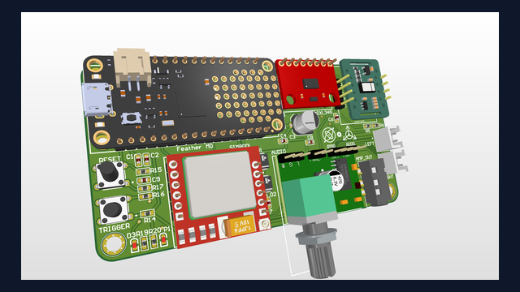
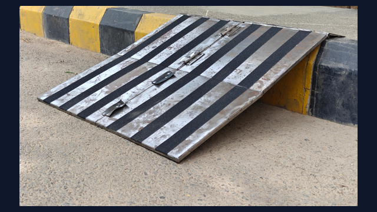
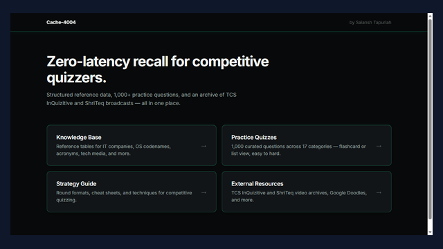

<p align="center">
  <h1 align="center">Saiansh Tapuriah</h1>
  <p align="center"><strong>Engineering Portfolio &bull; Edge AI &bull; Assistive Hardware &bull; Autonomous Systems &bull; High-Performance Web</strong></p>
  <p align="center">
    <a href="https://github.com/SaianshT"></a>
    <a href="https://www.linkedin.com/in/saiansh-tapuriah-6a375533a/"></a>
    <a href="mailto:saiansh1910@gmail.com"></a>
  </p>
</p>

---

## Featured Engineering Projects

A curated collection of four original engineering systems spanning wearable embedded computing, mechanical design patents, multi-agent AI platforms, and high-performance web applications.

<table align="center" width="100%">
  <tr>
    <td width="50%" valign="top">
      <p align="center">
        <a href="https://github.com/SaianshT/EpiAlert#readme"></a>
      </p>
      <h3 align="center"><a href="https://github.com/SaianshT/EpiAlert#readme">EpiAlert</a></h3>
      <p><strong>Problem:</strong> Over 50M individuals suffer from epilepsy; unwitnessed nocturnal seizures pose severe SUDEP risks, yet existing wearables fail when phone batteries die or cloud connections drop.</p>
      <p><strong>Solution:</strong> An autonomous medical wristband running on-device Multi-Centroid Hyperdimensional Computing (7.49 ms latency, 119-hour battery) with direct GSM cellular SMS/call emergency dispatch.</p>
      <p align="center">
        
        
        
        
      </p>
      <p align="center">
        <a href="https://github.com/SaianshT/EpiAlert#readme"></a>
      </p>
    </td>
    <td width="50%" valign="top">
      <p align="center">
        <a href="https://github.com/SaianshT/Ramp-Up#readme"></a>
      </p>
      <h3 align="center"><a href="https://github.com/SaianshT/Ramp-Up#readme">Ramp-Up</a></h3>
      <p><strong>Problem:</strong> Over 67% of urban public buildings lack ramps, where even a single 4–6 inch step halts wheelchair mobility; commercial portable ramps are too heavy (&gt;8 kg) for independent transit.</p>
      <p><strong>Solution:</strong> A granted Indian Design Patent (No. 506885-001) for a 3.2 kg foldable aluminum ramp that stows inside an under-seat wheelchair pouch and deploys in &lt;15 seconds tool-free.</p>
      <p align="center">
        
        
        
        
      </p>
      <p align="center">
        <a href="https://github.com/SaianshT/Ramp-Up#readme"></a>
      </p>
    </td>
  </tr>
  <tr>
    <td width="50%" valign="top">
      <p align="center">
        <a href="https://github.com/SaianshT/SaianshT/tree/main/projects/unlockED#readme"></a>
      </p>
      <h3 align="center"><a href="https://github.com/SaianshT/SaianshT/tree/main/projects/unlockED#readme">unlockED</a></h3>
      <p><strong>Problem:</strong> High school career counselors face overwhelming 1:500 student ratios, leading to unspotted prerequisite gaps, missed scholarship deadlines, and counselor burnout.</p>
      <p><strong>Solution:</strong> A multi-agent AI co-pilot (&quot;The Bloomberg Terminal for Counselors&quot;) using custom ReAct loops, deterministic knowledge graphs, and predictive ML models for gap analysis.</p>
      <p align="center">
        
        
        
        
      </p>
      <p align="center">
        <a href="https://github.com/SaianshT/SaianshT/tree/main/projects/unlockED#readme"></a>
        <a href="https://github.com/shayan-sethi/unlockED#readme"></a>
      </p>
    </td>
    <td width="50%" valign="top">
      <p align="center">
        <a href="https://github.com/SaianshT/Cache-4004#readme"></a>
      </p>
      <h3 align="center"><a href="https://github.com/SaianshT/Cache-4004#readme">Cache-4004</a></h3>
      <p><strong>Problem:</strong> Competitive tech quizzers face sub-second buzzer rounds where recall latency matters, but mainstream study tools are weighed down by bloated JS bundles and ads.</p>
      <p><strong>Solution:</strong> A zero-dependency single-page application with 1,000 curated questions, structured tech lore tables, and an algorithmic Fisher-Yates shuffle engine; powered back-to-back tournament victories.</p>
      <p align="center">
        
        
        
        
      </p>
      <p align="center">
        <a href="https://github.com/SaianshT/Cache-4004#readme"></a>
      </p>
    </td>
  </tr>
</table>

---

## Technical Competencies & Systems Spectrum

```text
[ Hardware & Embedded Edge AI ]
 ├── ARM Cortex-M0+ & Cortex-M4 Microcontroller Firmware (C++ / Arduino)
 ├── Multimodal Biosignal Sensing (I2C: ADXL345, MAX30102 PPG, TMP117)
 ├── Standalone Cellular Communications (SIM800L AT Command Automation)
 └── PCB Design & EDA (Assembly, 3D visualization, electrical schematic verification)

[ Applied AI & Machine Learning ]
 ├── Hyperdimensional Computing (HDC) & holographic binary vector representations
 ├── On-Device Continuous Learning & Online Centroid Clustering
 ├── Multi-Agent Orchestration (Custom ReAct loops, deterministic knowledge graphs)
 └── Scikit-Learn Predictive Modeling (Discover Uni higher-ed regression pipelines)

[ Mechanical Design & Accessibility ]
 ├── Sheet metal engineering, multi-axis hinge kinematics, and load-deflection analysis
 ├── Indian Design Patent Documentation & Intellectual Property prosecution
 └── Human-centric assistive mobility design & rapid physical prototyping

[ Software Engineering & Performance Web ]
 ├── Zero-dependency Vanilla JavaScript Single Page Applications (SPAs)
 ├── Algorithmic state machines & in-place array transformations (Fisher-Yates)
 └── Python backend infrastructure (Flask, JWT security, resilient offline fallbacks)
```

---

## Contact & Inquiries

- **Email:** [saiansh1910@gmail.com](mailto:saiansh1910@gmail.com)
- **LinkedIn:** [linkedin.com/in/saiansh-tapuriah-6a375533a](https://www.linkedin.com/in/saiansh-tapuriah-6a375533a/)
- **GitHub:** [@SaianshT](https://github.com/SaianshT)
