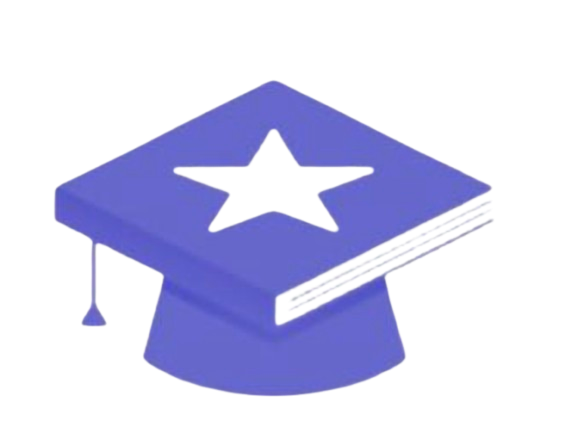

<p align="center">
  <h1 align="center">unlockED</h1>
  <p align="center"><strong>The Bloomberg Terminal for School Career Counselors &mdash; An Agentic AI Co-Pilot for Scalable Academic Guidance</strong></p>
  <p align="center">
    <a href="https://github.com/shayan-sethi/unlockED"></a>
    
    
    
  </p>
</p>

<p align="center">
  
</p>

---

## Overview & Core Wedge

In modern high schools, a single college counselor is routinely responsible for over **400 to 500 students**. Manually auditing transcripts, subject prerequisites, extracurricular portfolios, testing schedules, and scholarship deadlines across fragmented portals leads to severe administrative bottlenecks and unspotted student profile gaps.

### The Product Wedge: Counselor Augmentation, Not Replacement
Rather than building an ungrounded conversational chatbot—which introduces critical liability and hallucination risks when advising high school students—**unlockED** is engineered as a **Counselor Workbench and Co-Pilot**. It ingests student profiles, executes deterministic verification against exact university standards, and stages recommendations inside an editable human-in-the-loop dashboard.

---

## Core Capabilities

- **Application Recycling:** Benchmarks student GPAs, test scores, and activities against historical profiles of admitted alumni to recommend proven academic pathways.
- **Intelligent Gap Flagging:** Cross-checks high school subject selections against university prerequisites, immediately flagging mismatches (e.g., missing CUET/JEE mathematics or required laboratory sciences).
- **Automated Agentic Ingestion:** Bulk-parses unstructured resumes, transcripts, and certificates into standardized JSON schemas.
- **Opportunity Radar & Scholarship Monitor:** Continuously tracks high-impact academic competitions and funding opportunities, matching them to student profile gaps with transparent rationales.
- **Recommendation Studio (LOR Crafter):** Synthesizes 4-year cumulative student records into structured recommendation outlines within an embedded [Quill.js](https://quilljs.com/) editor, preserving the counselor's personal voice while eliminating blank-page drafting.

---

## System Architecture: PRISM Agent Engine

unlockED avoids off-the-shelf agent wrappers (LangChain, CrewAI) to eliminate black-box execution bloat. The multi-agent orchestrator was built from scratch in pure Python using a custom ReAct (Reason + Act) loop:

```text
[ Multi-Modal Data Ingestion ]
 ├── Student Transcripts & Activity Tiers (1, 2, 3)
 └── Target University Lists (India, UK, US Boards)
                            │
                            ▼
[ PRISM Orchestration Engine (agent.py) ]
 ├── groq_utils.py: Multi-key rotation (Llama 3.3 70B on Groq LPUs) with exponential backoff
 ├── Deterministic Knowledge Graph: Exact JSON/CSV cutoffs (Zero semantic RAG hallucinations)
 ├── reasoner.py: High-speed student profile gap analysis & academic risk deduction
 ├── planner.py: Feasibility-ranked remediation drafting
 └── opportunity_radar.py: Multi-parameter scholarship & competition matcher
                            │
                            ▼
[ Embedded Predictive ML Models (Joblib / Scikit-Learn) ]
 ├── Graduate Median Salary Predictor (£, 3 Yrs Post-Grad) ──> R² = 0.6411
 ├── First-Year Student Continuation Rate (%) ───────────────> R² = 0.4796
 └── Professional Employment / Further Study Rate (%) ───────> R² = 0.4061
                            │
                            ▼
[ Counselor Human-in-the-Loop Workbench ]
 ├── Priority Queue Dashboard (Tiered risk scoring)
 ├── Interactive Quill.js Rich Text Recommendation Editor
 └── Resilient Fallback: Mock Firebase JWT & local JSON database engine
```

### Deterministic Rule Pre-Validation & Guardrails
- Hard prerequisite gating rules are computed mathematically in Python before the LLM sees the prompt.
- `llm_scorer.py` enforces mathematical caps on match confidence scores (e.g., capping match probability at 45% if mandatory prerequisite exams are missing).

---

## Key Results & Recognition

- **3rd Place Winner:** Awarded 3rd Place at a competitive collaborative hackathon.
- **Leadership Role:** Saiansh Tapuriah served as **Team Lead and one of the senior programmers**, architecting the database schema, user/student authentication layer, deterministic scoring engine, and custom CSS UI system.
- **Predictive Regressors (Discover Uni KIS Dataset):**
  - **Graduate Median Salary:** $R^2 = 0.6411$, MAE = £1,427.24
  - **Continuation Rate:** $R^2 = 0.4796$, MAE = 7.30%
  - **Professional Employment Rate:** $R^2 = 0.4061$, MAE = 4.00%

---

## Hackathon Team & Cross-Functional Roles

Built collaboratively as an original hackathon prototype (3rd Place Winner at ShriTeq):

### Software Engineering & Technical Architecture
- **Saiansh Tapuriah** (`SaianshT`): **Team Lead & Senior Programmer** &mdash; architected the database schema, student profile models, deterministic pre-validation engine, and application state machine.
- **Shayan Sethi** (`shayan-sethi`): **Co-Developer & Collaborator** &mdash; original repository host, Groq API integration, and prompt engineering.
- **Devyansh Garg** (`Devonkedev`): **Co-Developer & Collaborator** &mdash; frontend UI views and test profile aggregation.

### Product Strategy, User Research & Pitch Presentation
- **Amaira Kapoor**: Product strategy, counselor workflow user research, and feature specification.
- **Vedant Rathi**: Hackathon pitch presentation, market positioning, and live demo delivery.
- **Sahil Bhatnagar**: Competitive benchmarking, opportunity radar analysis, and presentation strategy.

---

## Academic References, Datasets & Attributions

1. **Higher Education Statistics Agency (HESA) & Office for Students (OfS). (2024).** *Discover Uni Key Information Set (KIS) Dataset*. UK Government Open Data. Used for empirical training and cross-validation of graduate median salary, continuation rate, and professional employment regressors. Available at: [discoveruni.gov.uk](https://discoveruni.gov.uk/)
2. **Yao, S., Zhao, J., Yu, D., Du, N., Shafran, I., Narasimhan, K., & Cao, Y. (2022).** *ReAct: Synergizing Reasoning and Acting in Language Models*. International Conference on Learning Representations (ICLR 2023). [doi:10.48550/arXiv.2210.03629](https://arxiv.org/abs/2210.03629) &mdash; Foundational methodology for unlockED's custom multi-agent execution loop.
3. **Meta AI. (2024).** *The Llama 3 Herd of Models*. [arXiv:2407.21783](https://arxiv.org/abs/2407.21783) (Llama 3.3 70B Instruct Foundation Weights).
4. **Groq Inc. (2024).** *Groq LPU™ (Language Processing Unit) Systems Architecture* &mdash; High-throughput tensor streaming engine utilized for sub-second agent reasoning cycles.
5. **Pedregosa, F., et al. (2011).** Scikit-learn: Machine Learning in Python. *Journal of Machine Learning Research*, 12, 2825–2830.
6. **Slab. (2024).** *Quill.js Rich Text Editor*. Open-source interactive editing component. Available at: [quilljs.com](https://quilljs.com/)

<p align="center">
  <a href="https://github.com/shayan-sethi/unlockED"></a>
</p>
